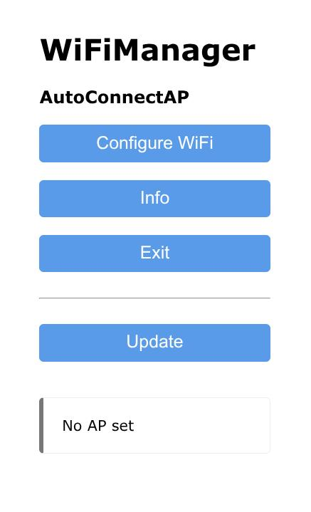
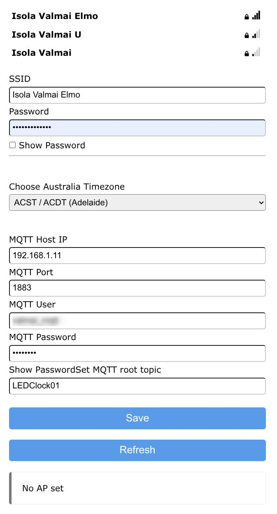

# HU-058D-LED-Display-ESP32
HU-058D LED Display that uses ESP32 and can be used standalone or with HomeAssistant.
This is forked from https://github.com/misterblack1/HU-058_ESPHome.
Hardware modifications include powering the buzzer off 3V3 and using a Wemos D1 ESP32 module to minimise space 

